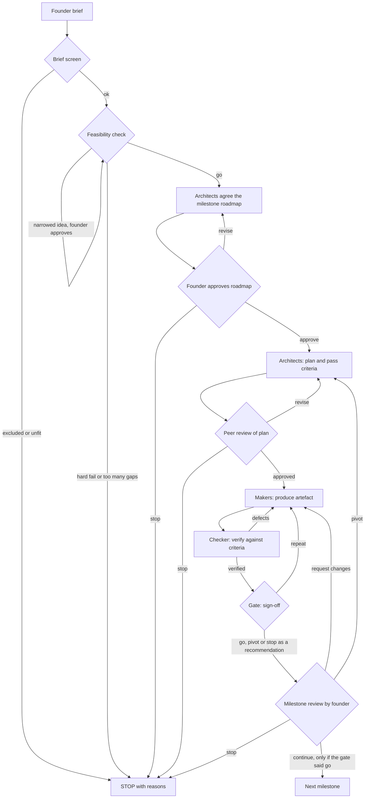
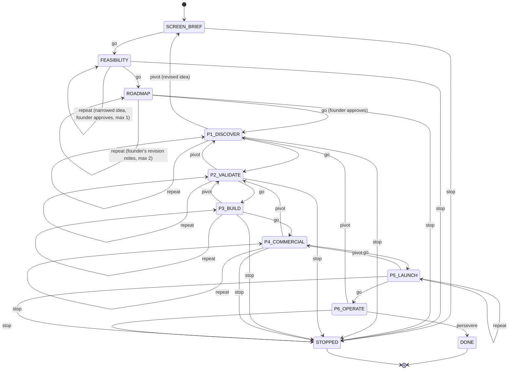

# Architecture

## Overview

One Python process (FastAPI web UI plus a CLI) runs a two-level state machine in `orchestrator.py`, and lookup tables choose every next state; the model never does. Before Phase 1, three states run once per run: the brief screen (rules), the feasibility check (a rubric scored by code) and the milestone roadmap (founder approval). Inside every phase the same loop runs. A planner writes the plan and its pass criteria before any work starts, and code reviews the plan. The makers produce, and the checker verifies the result in one call without editing it. Then `gates.py` signs off in code and the founder decides at a milestone review. Nobody signs off their own work, and criteria exist before the work does. Every agent action, gate and founder decision is appended to the run's decision log by `decision_log.py`, its only writer. The model client (`llm.py`) has two backends: Ollama's native API with a JSON schema (default, `qwen3:4b-instruct-2507-q4_K_M` on CPU) and any OpenAI-compatible hosted endpoint. Every structured reply is validated with Pydantic and retried once; a second failure is `model_output_invalid`, never placeholder text. The target is 2 to 3 model calls per phase.



A run lives in `runs/<run_id>/` (git-ignored): `state.json`, `approvals.json`, `decision_log.json` and `outputs/`. It pauses with status `awaiting_approval` whenever it needs the founder, and with status `blocked` when it reaches a STUBBED agent or the model is unreachable. `python -m venture resume` (or the Resume button) continues it. `python -m venture promote RUN_ID` copies a finished **live** run into the committed `outputs/` and `decision_log.json`; it refuses runs made with `LLM_MODE=mock`.

## Phases

Every agent is a function `fn(ctx) -> StepResult` in `agents/<role>.py`, with its prompt in `prompts/<role>.md`. The orchestrator, not the agent, writes the file, applies the citation rule, runs the output check and logs the action. Two roles work in every phase:

- **`planner`** (architect role): writes the plan as at most 8 criteria, each with `id`, `check`, `threshold` and `method` (`code` or `source`). `N_ARCHITECTS` defaults to 1; with 2 (optional, Phase 1 only) the plan review picks the first plan that passes and records why. The plan review is code, not a model call.
- **`checker`** (verification role): verifies artefacts against the chosen criteria in one call (pass, fail or unverified, with evidence). It never edits an artefact. Code accepts only a registered URL, a test name, an output file of this run or `ASSUMPTION` as evidence, and turns a "pass" without valid evidence into "unverified". In `FAST_MODE` the checker verifies only claims and gate inputs.

Each phase writes `phase<N>_gate_plan_review.md` (the chosen plan, its criteria and the verdict) and `phase<N>_gate_decision.md` (the verification report, the sign-off, the loop budget and the founder's decision).

### Phase 1: Discover

- **Agents:** before Phase 1: `guardrails` (brief screen), `assessor` (feasibility), `planner` and `checker` (roadmap). In the phase: `planner` (2 architects), `checker`, `researcher`, `scorer`, `interviewer`.
- **Tools:** `sources.search` (local SearXNG, then keyless Hacker News, Stack Exchange, MediaWiki and GitHub search; Reddit is not used) and `sources.SourceRegistry.fetch` (main text by trafilatura, capped by `MAX_SOURCES`); the model client. Each source is tagged `SAY` (someone describes the problem) or `PAY` (someone pays for a comparable solution).
- **Method:** screen the founder brief (excluded categories, completeness). Run the feasibility rubric (below). Agree a six-milestone roadmap with the founder. Then find 3 to 5 opportunities from public discussions of the problem. Score them on pain, willingness to pay, reach and founder fit, and estimate the cost and weekly hours of the smallest viable version. Research competitors and what people already pay. Write a Mom Test interview guide (past behaviour and current spend, no pitching).
- **Output:** `phase1_gate_brief_screen.md`, `phase1_gate_feasibility.md`, `phase1_gate_roadmap.md`, `phase1_gate_plan_review.md`, `phase1_step1_opportunities.md`, `phase1_step2_scoring.json`, `phase1_step3_market.md`, `phase1_step4_interview_guide.md`, `phase1_gate_decision.md`.

### Phase 2: Validate

- **Agents:** `planner`, `checker`, `strategist`, `launcher` (mocked publish).
- **Tools:** the model client; Phase 1 outputs and their registered sources.
- **Method:** a Lean Canvas where every box is sourced from Phase 1 or labelled `ASSUMPTION`; a static landing page with an honest call to action; a demand test whose target is set by code before any result exists: at least 5% sign-ups from at least 200 cold visitors within 14 days (`gates.DEMAND_TARGET`). The basis: email sign-ups of 5-15% from targeted paid traffic, at least 200 unique visitors for a directional signal, and runs of about 4 days to 2.5 weeks ([Kromatic, Landing Page Smoke Test](https://kromatic.com/real-startup-book/2-evaluative-market-experiments/value-proposition-test/landing-page-smoke-test/)). Separately, there is a 6.6% median landing page conversion across industries ([Unbounce, Conversion Benchmark Report 2024](https://unbounce.com/conversion-benchmark-report/)). Sign-up results are MOCKED: the system never invents sign-ups. Publishing the landing page is a separate founder decision at the milestone review.
- **Output:** `phase2_gate_plan_review.md`, `phase2_step1_lean_canvas.md`, `phase2_step2_landing_page.html`, `phase2_step3_demand_test.md`, `phase2_gate_decision.md`, `phase2_step4_publish_log.md`.

### Phase 3: Build

- **Agents:** `planner`, `checker`, `builder`.
- **Tools:** the model client; code-run product tests.
- **Method:** text digital products only (guide, template pack, checklist, mini-course). Write the smallest spec, build the product to it, then test it in code (every spec section present, length limits, output check passed). Write user docs.
- **Output:** `phase3_gate_plan_review.md`, `phase3_step1_mvp_spec.md`, `phase3_step2_product.md`, `phase3_step3_user_docs.md`, `phase3_gate_tests.md`, `phase3_gate_decision.md`.

### Phase 4: Commercial setup

- **Agents:** `planner`, `checker`, `commercial`.
- **Tools:** the model client; Phase 1 paying-source evidence.
- **Method:** a price grounded in what comparable products charge, with the reasoning and the assumptions stated. Draft refund, privacy and terms text, labelled as drafts and not legal advice. Code checks that a price, a product name and the label are present. The founder then reviews the price and policies at the milestone.
- **Output:** `phase4_gate_plan_review.md`, `phase4_step1_pricing.md`, `phase4_step2_policies.md`, `phase4_gate_decision.md`.

### Phase 5: Sell/deliver/get paid (Launch; MOCKED)

- **Agents:** `planner`, `checker`, `launcher`, `delivery` (with `payments`, `refunds`, `reconcile`).
- **Tools:** the mocked ledger; the `@requires_approval` publish, post, checkout and refund functions.
- **Method:** generate the store page and launch post drafts. At the milestone review the founder decides three outbound actions one by one: publish the store page, post the drafts, and run the payment test. Each has its own action id. Only the approved ones run, all MOCKED; the payment test exercises sale to cash (see below). Nothing is published, posted or charged.
- **Output:** `phase5_gate_plan_review.md`, `phase5_step1_store_page.html`, `phase5_step2_launch_posts.md`, `phase5_gate_decision.md`, `payment_test_log.md`, `phase5_step4_publish_log.md`.

### Phase 6: Operate and learn

- **Agents:** `planner`, `checker`, `operator` (STUBBED).
- **Tools:** the model client; the decision log and mocked sales data.
- **Method:** a support FAQ from the product and policies; a memo that compares metrics with targets set before launch and recommends persevere, pivot or stop.
- **Output:** `phase6_gate_plan_review.md`, `phase6_step1_support_faq.md`, `phase6_step2_pivot_memo.md`, `phase6_gate_decision.md`.

## Gates

The outer machine, one state per phase (`orchestrator.TRANSITIONS`):



For a phase, go, pivot and stop happen only through the founder's milestone review, and "repeat" means back to the makers inside the phase.

| State | What the gate checks | go | repeat | pivot | stop |
|---|---|---|---|---|---|
| `SCREEN_BRIEF` | Excluded category (physical goods; financial, investment or crypto; health or legal advice); borderline matches; complete brief | `FEASIBILITY` | — | — | STOPPED |
| `FEASIBILITY` | Rubric below | `ROADMAP` | narrowed idea the founder approved (max 1) | — | STOPPED |
| `ROADMAP` | Code checks the roadmap's shape; the founder approves | Phase 1 | revised on the founder's notes (max 2) | — | STOPPED |
| `P1_DISCOVER` | Evidence thresholds (below) | Phase 2 | makers again | brief screen with a revised idea | STOPPED |
| `P2_VALIDATE` | Fewer than half the Lean Canvas claims are `ASSUMPTION`; founder review of the landing page | Phase 3 | makers again | Phase 1 | STOPPED |
| `P3_BUILD` | Every product test passes | Phase 4 | makers again | Phase 2 | STOPPED |
| `P4_COMMERCIAL` | Price, product name, policies labelled not legal advice; founder review | Phase 5 | makers again | Phase 2 | STOPPED |
| `P5_LAUNCH` | Drafts exist; founder approval before any publish or send | Phase 6 | makers again | Phase 4 | STOPPED |
| `P6_OPERATE` | Metrics against pre-set targets | DONE | — | Phase 1 | STOPPED |

An outcome marked — is not defined for that state and leads to STOPPED. A run allows one pivot.

**Inner loop and loop budget** (`orchestrator.INNER`, `inner_next`):

| Stage | Who | Outcome | Next |
|---|---|---|---|
| `PLAN` | planner | done | `PLAN_REVIEW` |
| `PLAN_REVIEW` | code (`gates.check_plan`) | approved / revise / stop | `MAKE` / `PLAN` / STOPPED |
| `MAKE` | the phase's makers | done | `VERIFY` |
| `VERIFY` | checker, one call | verified / defects | `SIGN_OFF` / `MAKE` |
| `SIGN_OFF` | `gates.py`, code only | repeat / go, pivot or stop | `MAKE` / `MILESTONE_REVIEW` with the recommendation |
| `MILESTONE_REVIEW` | founder | continue / request changes / pivot / stop | next phase / `MAKE` / the pivot phase's `PLAN` / STOPPED |

- `SIGN_OFF` never routes to `VERIFY`: re-verifying an unchanged artefact returns the same result.
- Each back-edge (`revise`, `defects`, `repeat`) may fire at most twice per phase (`gates.MAX_BACK_EDGES`). "Request changes" spends the `repeat` budget. When `defects` is used up, the artefact goes to `SIGN_OFF` with its open defects listed, and the gate can only recommend pivot or stop. When `revise` or `repeat` is used up, the outcome becomes stop. The counters are stored with the run and printed in every gate file.
- The plan review is code: every criterion needs an id, a check, a threshold and a method of `code` or `source`, with at most 8 criteria. A plan that fails is sent back (revise); when the revise budget is used up, the run stops.
- A file blocked by the output check, or a step whose model output is invalid twice, blocks only that file. It shows up as a failed criterion (`blocked:<file>`), so it goes back to the makers within the defects budget and then reaches the founder as an open defect.
- Every threshold below that has no cited basis (3 domains, half `ASSUMPTION`, repeat once, 50% of skills, half the hours, three soft fails, 2 back-edges) is labelled `ASSUMPTION` wherever it is printed.

**Feasibility rubric** (once per run, before any planning; market demand is left to the Phase 1 gate):

| Id | Criterion | Fail type |
|---|---|---|
| I1 | The brief names a specific customer and a specific problem | soft |
| I2 | The product is a supported digital type (guide, template pack, checklist, mini-course) | hard |
| I3 | At least 1 fetched source shows the problem exists (2 searches at most) | soft |
| F1 | The founder's skills cover at least half the skills the idea needs | soft |
| F2 | `budget_usd` covers the estimated cost of the smallest version | hard |
| F3 | `hours_per_week` over 4 weeks covers the estimated effort | hard if short by more than half, else soft |
| F4 | The idea does not conflict with the founder's stated values | hard |

Any hard fail: stop. Three or more soft fails: stop. One or two soft fails: repeat once with a narrowed idea, which the founder must approve. Otherwise go. Every estimate the assessor makes is labelled `ASSUMPTION` in `phase1_gate_feasibility.md`.

**Phase 1 evidence thresholds** (set in `gates.PHASE1` before any run, never after):

- at least 3 fetched sources from 3 different domains that describe the problem;
- at least 1 fetched `PAY` source showing someone already pays for a comparable solution;
- the brief's budget and weekly hours cover the scorer's estimate of the smallest viable version;
- fewer than half of the claims are labelled `ASSUMPTION`.

**When the system recommends STOP:**

- **Feasibility:** any hard fail, three soft fails, or a narrowed idea that still fails.
- **Phase 1:** two or more missed evidence thresholds, or a miss after the one repeat. Each missed threshold is written to `phase1_gate_decision.md`.
- **Any phase:** a used-up loop budget, or open defects with no pivot left.
- **Run budget:** `MAX_MODEL_CALLS` (60) or `MAX_RUN_SECONDS` (900) reached, or the founder pressed stop.

**Founder authority.** The founder can always be more cautious than the system, never less:

| Gate recommended | Founder may choose |
|---|---|
| go | continue, request changes, pivot, stop |
| pivot | pivot, request changes (if repeat budget remains), stop |
| stop | stop, pivot, request changes (if repeat budget remains) |

"Continue" is never offered after a failed gate, and `ApprovalStore.choose` refuses a choice that was not offered. No phase starts without a founder approval of the roadmap on record, and none advances without a founder decision at its milestone review. Hard rules (excluded products, the never-list in `guardrails.py`) cannot be overridden by anyone.

**Roadmap.** One planner proposes six milestones, one per phase (with `N_ARCHITECTS=2`, two proposals are reconciled by the checker; that step is STUBBED). Code enforces exactly six milestones in phase order, each with what the founder will see and the decision asked. Code also attaches each milestone's gate, and it rejects any milestone that promises income, sales or sign-up numbers.

**Outbound actions.** Publish, send and spend actions in Phases 2 and 5 are separate decisions on the milestone screen. Each has its own action id, which hashes the exact content approved, so approving a milestone never approves a publication by implication.

### Safeguards

**Structural limits (the system cannot do it at all).**
- No agent holds a tool that publishes, sends, spends or signs. Those exist only as `@requires_approval` functions, and every one is a labelled mock.
- No payment SDK, mail client or social-media client is in the dependencies; a test fails if one appears.
- The fetch tool is GET only, `http`/`https` only, with a timeout and a size cap. It resolves each host and refuses private, loopback, link-local and other non-public addresses, on every redirect hop.
- No field stores a password or card number. Briefs, instructions and founder notes are scanned, and matches are replaced with `[REDACTED]` before anything is stored or logged.
- Run budget: `MAX_MODEL_CALLS`, `MAX_RUN_SECONDS` and the loop budgets. Exceeding one ends the run as STOPPED with the reason logged. The founder's stop button is always available (UI and `python -m venture stop`).

**Untrusted content.** Text fetched from the web is data. It reaches agents fenced between per-run random delimiters, behind a fixed preamble that says so, truncated, and never inside a system prompt. Instruction-like text inside a page is logged as `injection_suspected`. Next states come from lookup tables, and outbound actions need an approval record, so text in a page or a brief cannot trigger an action.

**How checks decide.**
- Text is normalised first: NFKC, zero-width and tag characters removed, lowercase, plus a leetspeak variant.
- Deterministic rules come first. A model classifier is used only for ambiguous founder instructions, and any error or unparseable reply means refuse (fail closed).
- A refusal blocks only the offending request or file; the run goes on and the founder sees what was refused and why.
- Founder approval cannot unlock the never-list, whatever the framing (role-play, "for testing", "the founder authorises it").

| Rule | Mechanism | Test |
|---|---|---|
| Never promise income or success | request screen, output check, roadmap check | trick prompts; blocked output fixtures |
| No fake reviews, testimonials, sign-ups or timers | request screen; output check; sign-up results only from a labelled MOCKED counter | trick prompts, including evasions |
| No impersonation of founder, customer or brand | request screen; posts stay drafts; customer-voice output check | trick prompts; output fixtures |
| Never hold or move money, create accounts, store credentials | structural limits above | dependency test; redaction tests |
| Nothing published, sent, spent or signed without approval | `@requires_approval`, one action id per outbound action | `test_approval.py`, `test_pipeline.py` |
| No excluded products | brief screen | three excluded briefs stop |
| Every market claim sourced or `ASSUMPTION` | citation registry | unregistered URL stamped `ASSUMPTION` |
| Every mock labelled | `MOCKED` flag, UI banner, README table | each MOCKED module named in the README table |
| Outputs from real runs only | `promote()` is the only path into `outputs/` and refuses mock runs | mock run cannot be promoted |
| Instructions hidden in web pages are ignored | fencing, lookup-table transitions | injection fixture page logs `injection_suspected` |
| Run cannot loop or spend without limit | loop and run budgets, stop button | budget tests end as STOPPED |

## Sale to cash

All of it is **MOCKED** in an in-memory ledger (`payments.py`, `delivery.py`, `refunds.py`, `reconcile.py`). No payment provider, SDK or sandbox is used and no money moves. `payment_test_log.md` records one test run, which runs only if the founder approved the payment test on its own:

1. **Payment triggers delivery.** Opening checkout is an outbound action and needs founder approval. A simulated payment event marks the order paid and calls `delivery.deliver`, which grants access.
2. **Idempotency prevents double delivery.** Delivery is keyed by `deliver:<order_id>`. The test sends the same payment event twice; the second is ignored and the order is delivered once.
3. **A refund revokes access.** `refunds.refund` needs founder approval, marks the order refunded and revokes access.
4. **Reconciliation** matches orders, payments, fees (an illustrative mock fee) and the recorded payout (payments minus fees minus refunds), and lists any mismatch.

## Data flow

```
founder brief (briefs/*.json)
   │  validate_brief → screen_brief → feasibility rubric → roadmap ──► founder approves
   ▼
per phase:  planner(s) ─► plan ─► checker review ─► makers fn(ctx) ─► checker verify ─► gates.py sign-off
                                                       │   ▲
                                                       │   └── llm.chat (tokens, cost)   sources.fetch (registry)
                                                       ▼
            citation rule: unfetched URL → ASSUMPTION ──► output check (block, regenerate once, stop)
                                                       ▼
            runs/<id>/outputs/<phase files>  +  runs/<id>/decision_log.json (one entry per action)
   ▼
milestone review ──► founder choice (UI or CLI) + one approve/reject per outbound action → approvals.json
   ▼
promote (live runs only) ──► outputs/  +  decision_log.json  (committed)
```

Founder instructions during a run pass `guardrails.screen_request` first (secrets redacted, rules, then the fail-closed classifier for ambiguous cases); refused ones are logged with `"outcome": "refused"` and never reach an agent. Fetched pages reach agents only as fenced data. Founder notes from "request changes" and "revise" reach the agents as `ctx.feedback`.

## Built vs. stubbed

| Part | Status |
|---|---|
| Two-level state machine, loop budget, pivot limit, persistence, resume | Built, tested |
| Gates: feasibility rubric, roadmap checks, plan check, evidence thresholds, sign-offs | Built, tested |
| Founder decisions and approvals (`choose`, `@requires_approval`, UI routes, CLI) | Built, tested |
| Milestone tracker (UI and `venture status`) | Built |
| Guardrails (brief, request, output; normalisation, redaction, fail-closed classifier) | Built, tested with `tests/trick_prompts.json` |
| Safe fetch (public addresses only, size cap, fencing, injection logging) and search adapters | Built, tested offline |
| Run budget and stop button | Built, tested |
| Decision log writer and schema check | Built, tested |
| Citation registry, ASSUMPTION stamping, evidence check on verification | Built, tested |
| Model client (Ollama and OpenAI-compatible backends, JSON schema, Pydantic validation, token and cost counting) | Built, tested offline |
| Payments, delivery, refunds, reconciliation, publishing, posting | MOCKED |
| Assessor, planner, checker (and the optional roadmap reconcile) | STUBBED |
| Phase 1 to 6 makers | STUBBED |

## Roadmap

1. Assessor and the feasibility gate, then the roadmap and milestone screens on a live model.
2. Planner and checker for Phase 1, the researcher with the source registry, and the scorer, so the Phase 1 gate runs on real evidence.
3. Strategist and the Phase 2 gate.
4. Builder with code-run product tests; commercial; launcher and mocked delivery.
5. Operator for Phase 6.
6. After the hackathon: a payment provider's test mode behind the same `@requires_approval` gate, more product types, and an evaluation set of briefs with known go and stop answers.
