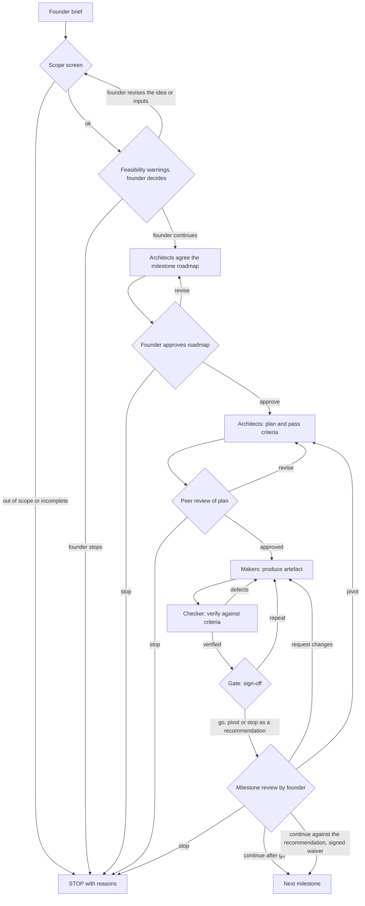
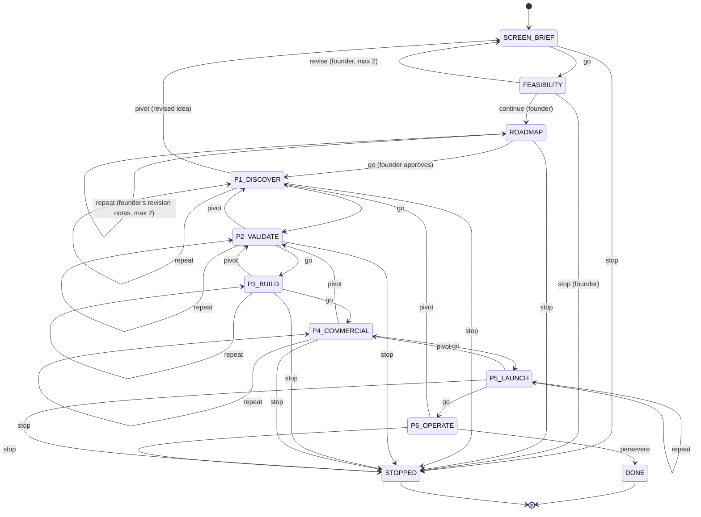

# Architecture

## Overview

One Python process (a FastAPI web UI plus a CLI) runs a two-level state machine in `orchestrator.py`; lookup tables choose every next state, and the model never does. Before Phase 1, three states run once per run: the scope screen (rules; an out-of-scope idea stops at once), the feasibility check (warnings computed by code; the founder decides) and the milestone roadmap (founder approval). Inside every phase the same loop runs: a planner writes the pass criteria before any work starts, code reviews the plan, the makers produce the files, a checker verifies them in one call without editing them, `gates.py` signs off in code, and the founder decides at a milestone review. Nobody signs off their own work. Every agent action, gate and founder decision is appended to the run's decision log by `decision_log.py`, its only writer. The model client (`llm.py`) uses a local open-weight model through Ollama's native API with a JSON schema (default `qwen3:4b-instruct-2507-q4_K_M` on CPU) or any OpenAI-compatible endpoint; every structured reply is validated with Pydantic and retried once, and a second failure is recorded as `model_output_invalid`, never replaced with placeholder text.



A run lives in `runs/<run_id>/` (git-ignored): `state.json`, `approvals.json`, `decision_log.json` and `outputs/`. It pauses with status `awaiting_approval` whenever it needs the founder, and with status `blocked` when it reaches a STUBBED agent or the model is unreachable. `python -m venture resume` (or the Resume button) continues it. `python -m venture promote RUN_ID` copies a finished **live** run into the committed `outputs/` and `decision_log.json`; it refuses runs made with `LLM_MODE=mock`.

## Phases

Every agent is a function `fn(ctx) -> StepResult` in `agents/<role>.py`, with its prompt in `prompts/<role>.md`. The orchestrator, not the agent, writes the file, applies the citation rule, runs the output check and logs the action. Two roles work in every phase:

- **`planner`** (architect role): the plan is a template in `gates.py` (`CRITERIA_TEMPLATE`). Code writes the sign-off gate's own checks into every plan (`G1`, `G2`, ...) and a short list of quality checks per phase (`C1`, ...), each about one file and of a kind code can measure (a count, required fields, a minimum length, a price, sections, questions without a pitch). In one small call the planner may move a threshold inside its allowed range and add at most two more checks of the same kinds; an invalid reply falls back to the template. With `FAST_MODE` the template is used as it is and no model is called. The makers are shown the approved plan. The plan review is code, not a model call.
- **`checker`** (verification role): every criterion in the template is measured by code from the files and their data, so verification makes no model call. The checker agent is asked, once, only for a criterion of a kind code does not know. It never edits an artefact. With `LENIENT_CHECKS` (on with `FAST_MODE` unless set) a failed quality check is listed for the founder under "Quality notes for the founder" and does not send the phase back; a file that was not written still does, and the gate's own checks are not affected.
- **Rework:** when a check fails, only the step that owns the failed file is run again, plus any step that reads what changed (`DEPENDS` in `orchestrator.py`); kept steps are logged as `kept_<step>`. A gate repeat runs again only the step tied to the check that missed.
- **Search:** the queries of a step run at the same time and so do the page downloads (`SEARCH_WORKERS`, default 4, at most two requests per engine at once). Pages are registered one at a time in ranked order, so the source budget, one page per domain and the junk-page check hold as before.
- **Founder evidence:** the founder can add links and statements at a decision screen. A fetched link is a source like any other and is used before any search. With `FOUNDER_EVIDENCE_FIRST` (on by default) one fetched founder link that shares a content word with the brief settles the check it is about (problem sources, someone already pays, or demand; the kind "traction" counts for pay and demand). The check then reads "met by founder-provided evidence" and the decision line says so. A statement without a link is recorded as `ASSUMPTION (founder-stated)` and never counts. Without a founder link the thresholds below decide, and when no page with a price is found the pay check is reported as unknown, not as a miss.

Each phase writes `phase<N>_gate_plan_review.md` (the chosen plan, its criteria and the verdict) and `phase<N>_gate_decision.md` (the sign-off, the verification report, the loop budget and the founder's decision). Every output file opens with one line written by code: phase and step, agent, model and the run's start time. A gate file then states `Decision:` with its reasons on the next line, and a claim line ends with its source URL or the word `ASSUMPTION`.

### Phase 1: Discover

- **Agents:** before Phase 1: `guardrails` (scope screen), `assessor` (feasibility), `planner` and `checker` (roadmap). In the phase: `planner`, `checker`, `researcher`, `scorer`, `interviewer`.
- **Tools:** `sources.search` (local SearXNG, then keyless Hacker News, Stack Exchange, MediaWiki and GitHub search; Reddit is not used; every request sends a User-Agent with the project name and `CONTACT_URL`) and `sources.SourceRegistry.fetch` (main text by trafilatura; `MAX_SOURCES` new pages per agent step); the model client. Each source is tagged `SAY` (someone describes the problem) or `PAY` (someone pays for a comparable solution).
- **Method:** screen the idea for scope (out-of-scope categories, completeness). Show the feasibility warnings (below) and wait for the founder's choice. Agree a six-milestone roadmap with the founder. Then the researcher searches and fetches public pages, lists the evidence that the founder's problem exists, and gives 2 to 4 opportunities, each a customer segment with that problem. The model points at pages by number and code supplies the URL, so it never types one; a statement with no page behind it is printed as `ASSUMPTION`. The scorer gives 1 to 5 on pain, willingness to pay, reach and founder fit, and estimates the cost and weekly hours of the smallest version; code adds the totals and picks. The researcher then looks for comparable paid products (`PAY`). The interviewer writes a Mom Test guide (past behaviour and current spend, no pitching); a schema check rejects hypothetical questions, and no interviews are run. Each agent step is one model call, so Phase 1 takes six.
- **Output:** `phase1_gate_brief_screen.md`, `phase1_gate_feasibility.md`, `phase1_gate_roadmap.md`, `phase1_gate_plan_review.md`, `phase1_step1_opportunities.md`, `phase1_step2_scoring.json`, `phase1_step3_market.md`, `phase1_step4_interview_guide.md`, `phase1_gate_decision.md`.

### Phase 2: Validate

- **Agents:** `planner`, `checker`, `strategist`, `launcher` (mocked publish).
- **Tools:** the model client; Phase 1 outputs and their registered sources.
- **Method:**
  - **Lean Canvas:** one model call fills ten boxes. An entry cites a numbered line of Phase 1 evidence, and code supplies the URL; any other entry is printed as `ASSUMPTION`.
  - **Landing page:** one model call writes the copy, and code puts it into a fixed template. The template has no testimonial block, no countdown and no earnings figures, and it says on the page that it is a draft whose form is not connected.
  - **Demand test:** no model call. The target is set by code before any result exists: at least 5% sign-ups from at least 200 cold visitors within 14 days (`gates.DEMAND_TARGET`). The basis: email sign-ups of 5-15% from targeted paid traffic, at least 200 unique visitors for a directional signal, and runs of about 4 days to 2.5 weeks ([Kromatic, Landing Page Smoke Test](https://kromatic.com/real-startup-book/2-evaluative-market-experiments/value-proposition-test/landing-page-smoke-test/)). Separately, there is a 6.6% median landing page conversion across industries ([Unbounce, Conversion Benchmark Report 2024](https://unbounce.com/conversion-benchmark-report/)).
  - **Result:** the sign-up count comes only from the MOCKED counter in `demand.py`, which reads zero, so the system never invents sign-ups. The result is reported as not measured, and the gate says demand is not validated.
  - **Publishing:** a separate founder decision at the milestone review, and MOCKED.
- **Output:** `phase2_gate_plan_review.md`, `phase2_step1_lean_canvas.md`, `phase2_step2_landing_page.html`, `phase2_step3_demand_test.md`, `phase2_gate_decision.md`, `phase2_step4_publish_log.md`.

### Phase 3: Build

- **Agents:** `planner`, `checker`, `builder`.
- **Tools:** the model client; code-run product tests.
- **Method:** every digital product is accepted. The builder writes text deliverables; for a software, media or design product it writes the specification and the written content, not the code or the recording. One model call writes the smallest spec (3 to 5 sections and what is left out). One call writes every section of the product. Code then runs four acceptance tests on the text: every spec section is present, every section has enough content, the product is short enough to check, and no placeholder text is left. A failed test sends the work back to the makers. One more call writes the user docs. With `SITE_TEMPLATES=true` and a text product, the builder also assembles a small static site (`site_builder.py`): the model supplies four short texts, code copies the rest from the product draft and renders fixed templates, so the model writes no HTML. Every page carries the draft banner, has no form, script or outside address, and its buy control is MOCKED; the gate checks this in code.
- **Output:** `phase3_gate_plan_review.md`, `phase3_step1_mvp_spec.md`, `phase3_step2_product.md`, `phase3_step3_user_docs.md`, `phase3_gate_tests.md`, `phase3_gate_decision.md`.

### Phase 4: Commercial setup

- **Agents:** `planner`, `checker`, `commercial`.
- **Tools:** the model client; Phase 1 paying-source evidence.
- **Method:** one model call recommends a price; each reason cites a numbered line of Phase 1 market evidence or is printed as `ASSUMPTION`, and no sales are forecast. One call drafts refund, privacy and terms text; code adds the heading that says they are drafts and not legal advice. Code checks that a price, a product name and the label are present. The founder then reviews the price and policies at the milestone.
- **Output:** `phase4_gate_plan_review.md`, `phase4_step1_pricing.md`, `phase4_step2_policies.md`, `phase4_gate_decision.md`.

### Phase 5: Sell/deliver/get paid (Launch; MOCKED)

- **Agents:** `planner`, `checker`, `launcher`, `delivery` (with `payments`, `refunds`, `reconcile`).
- **Tools:** the mocked ledger; the `@requires_approval` publish, post, checkout and refund functions.
- **Method:** one model call writes the store page copy, which code puts into a fixed template (no testimonials, countdowns or earnings figures; the buy button is not connected). One call drafts 2 or 3 launch posts in the founder's own voice for the founder to post. At the milestone review the founder decides three outbound actions one by one: publish the store page, post the drafts, and run the payment test. Each has its own action id. Only the approved ones run, all MOCKED; the payment test exercises sale to cash (see below). Nothing is published, posted or charged.
- **Output:** `phase5_gate_plan_review.md`, `phase5_step1_store_page.html`, `phase5_step2_launch_posts.md`, `phase5_gate_decision.md`, `payment_test_log.md`, `phase5_step4_publish_log.md`.

### Phase 6: Operate and learn

- **Agents:** `planner`, `checker`, `operator`.
- **Tools:** the model client; the MOCKED sign-up counter (`demand.py`).
- **Method:** one model call writes a support FAQ from the product, the user docs, the price and the draft policies; anything about money goes to the founder. The memo's metrics and its recommendation are made by code. A metric comes only from a counter, and the counter is MOCKED and reads zero, so the metric is reported as not measured. The memo's list of what the run showed is written by code from the run's facts. One model call adds only the riskiest assumptions and what to measure next.
- **Output:** `phase6_gate_plan_review.md`, `phase6_step1_support_faq.md`, `phase6_step2_pivot_memo.md`, `phase6_gate_decision.md`.

## Gates

| Gate (state) | What it checks | Outcomes | Recommends STOP when |
|---|---|---|---|
| Scope screen (`SCREEN_BRIEF`) | Out-of-scope category (health or medical; financial or investment, including crypto; legal; physical goods), on the brief and again on every revised idea, founder note and pivot; and a complete brief | go to feasibility; stop | The idea is out of scope: the run stops at once with one fixed reply, no agent is called and the founder cannot override it. Also when the brief is incomplete |
| Feasibility (`FEASIBILITY`) | Seven warnings (below), each major, minor or none, computed by code from the brief and the assessor's estimates. It gives no verdict and does not look at market demand | the founder chooses: continue to the roadmap; revise the idea or the inputs and be checked again from the scope screen (2 at most); stop | Never by itself. With two or more major warnings the screen recommends "revise or stop", and the founder decides |
| Roadmap (`ROADMAP`) | Six milestones in phase order, each with what the founder will see and the decision asked; no promised income, sales or sign-up numbers | go when the founder approves; repeat on the founder's notes (2 at most); stop | The founder stops. A plan that fails its checks twice pauses the run, and the founder chooses retry or stop |
| Phase 1 evidence (`P1_DISCOVER`) | 3 sources from 3 domains that describe the problem; 1 `PAY` source in which code finds a price; the founder's budget and hours cover the estimate; fewer than half the claims are `ASSUMPTION`. A threshold with nothing to measure is listed as not measured and is not a miss | go to Phase 2; repeat once with new searches; pivot to the brief screen with a revised idea; stop | Two or more measured thresholds are missed, or one is still missed after the repeat. When no fetched page supports any claim, the thresholds are not evaluated: the gate asks for a repeat, then recommends STOP with the reason `no_evidence_collected` and says this is not a verdict on the idea |
| Phase 2 (`P2_VALIDATE`) | The canvas Problem and Customer boxes each cite Phase 1 evidence; the landing page has an email form; a measured demand result must meet the target set beforehand (a MOCKED one is reported, not counted) | go to Phase 3; repeat once; pivot to Phase 1; stop | A check is still missed after the repeat |
| Phase 3 product tests (`P3_BUILD`) | Four acceptance tests that code runs on the product text | go to Phase 4; repeat once; pivot to Phase 2; stop | A test still fails after the repeat |
| Phase 4 (`P4_COMMERCIAL`) | A price, the product name, and policies labelled as drafts and not legal advice | go to Phase 5; repeat once; pivot to Phase 2; stop | A check is still missed after the repeat |
| Phase 5 (`P5_LAUNCH`) | The store page and post drafts exist; each outbound action has its own founder decision | go to Phase 6; repeat once; pivot to Phase 4; stop | A check is still missed after the repeat |
| Phase 6 (`P6_OPERATE`) | Every metric with a target set beforehand is measured and met | go (persevere) to done; pivot to Phase 1 on a measured miss; stop | A metric is not measured. The counter is MOCKED in this prototype, so a full run ends with STOP, and the decision file says it is not a verdict on the idea |

Every gate is code in `gates.py`; no model call decides an outcome. In any phase the gate also recommends STOP when the loop budget is used up, or when defects stay open and the run's one pivot is spent. After the founder's feasibility decision the system does not end a run by itself: when `MAX_MODEL_CALLS` or `MAX_RUN_SECONDS` is reached, the run pauses and the founder chooses to extend the budget or stop. The run ends as STOPPED when the founder stops it, or when the scope screen or the never-list rules refuse a brief, a revised idea or a founder note.

The outer machine, one state per phase (`orchestrator.TRANSITIONS`):



For a phase, go, pivot and stop happen only through the founder's milestone review, and "repeat" means back to the makers inside the phase. An outcome that is not defined for a state leads to STOPPED. A run allows one pivot.

**Founder authority.** The founder can always be more cautious than the system, never less:

| Gate recommended | Founder may choose |
|---|---|
| go | continue, request changes, pivot, stop |
| pivot | pivot, request changes (if repeat budget remains), stop, or continue with a signed waiver |
| stop | stop, pivot, request changes (if repeat budget remains), or continue with a signed waiver |

From Phase 1 onwards plain "continue" is never offered after a failed gate. At any phase gate the founder may instead sign a waiver: a separate control, "Continue against the recommendation", that is refused without a written reason. The gate's recommendation and its failed criteria stay in the decision file unchanged, no criterion is marked as passed, the log entry has outcome `waiver` with the reason and the criteria, and every later file header, review and the run view carry "Continued against a STOP recommendation at M<N>". The scope screen, the never-list and publish or send approvals cannot be waived. After the feasibility check the system never ends a run on its own: where it used to stop (a used-up loop budget, a reached run budget, a roadmap or a model reply that fails twice) it pauses, says what happened and asks the founder, who may retry, extend the budget or stop; a plan that fails its review twice goes on with the gate's own criteria only. A run ends in STOPPED only when the founder chooses stop, or when the scope screen stops a revised idea. Also, and `ApprovalStore.choose` refuses a choice that was not offered. The feasibility check is the one place where the founder may go ahead against the system's recommendation, because it rests on estimates about the founder's own skills, money and time; the roadmap and every later milestone file then carry the line "Continued with N major feasibility warnings". No phase starts without a founder approval of the roadmap on record, and none advances without a founder decision at its milestone review. Publish, send and spend actions in Phases 2 and 5 are separate decisions on the milestone screen; each has its own action id, which hashes the exact content approved, so approving a milestone never approves a publication by implication. Hard rules (excluded products, the never-list in `guardrails.py`) cannot be overridden by anyone.

**Feasibility warnings** (before any planning, and again after every revision; market demand is left to the Phase 1 gate):

| Id | Looks at | Major when | Minor when |
|---|---|---|---|
| `W-CUSTOMER` | The customer and problem named in the brief | never | Either is missing or generic |
| `W-SIGNAL` | A quick search (2 at most) for a sign that the problem exists | never | Nothing is found |
| `W-BUILD` | The product family and the channel it is sold through | The product itself is Software or Media and design: the Build phase writes a specification, not the product | The family could not be placed, or the product is text-based but the idea names its own platform, website, app or store. A word for where the product is sold is the channel, not the product |
| `W-SKILLS` | The skills the idea needs, against the founder's skills | A skill needed to make the product itself is missing | Only supporting skills are missing |
| `W-BUDGET` | `budget_usd`, against the estimated cost of the smallest version | The budget does not cover it | It covers it with less than a fifth left (`ASSUMPTION`) |
| `W-TIME` | Hours available, (`hours_per_week` + `delegated_hours_per_week`) x `timeframe_weeks`, against the estimated effort. The founder sets the time frame; when none is given the screen asks for it and 4 weeks are used, labelled `ASSUMPTION` | They cover less than half | They cover between half and all |
| `W-VALUES` | The idea, against the founder's stated values | The assessor selects one stated value as in conflict | never |

Each warning states the fact behind it, its evidence (a fetched URL, the brief field used, or `ASSUMPTION`) and ways to address it. The screen shows major warnings first and a recommendation that is never enforced: proceed (no major warning), proceed with care or revise (one), revise or stop (two or more). The founder then chooses continue, revise or stop. Every estimate the assessor makes is labelled `ASSUMPTION` in `phase1_gate_feasibility.md`.

A digital product is anything delivered in digital form with nothing shipped: written content, courses and learning, templates and tools, software, media and design, and access. A word in the idea decides the family before the model's answer does, and a format that cannot be placed is a minor warning, never a stop.

**Phase 1 evidence thresholds** (set in `gates.PHASE1` before any run, never after):

- at least 3 fetched sources from 3 different domains that describe the problem;
- at least 1 fetched `PAY` source showing someone already pays for a comparable solution. The model proposes the `PAY` tag, and code keeps it only when it finds a price in the page's text; otherwise the claim is downgraded and the downgrade is logged. Basis: what people do is stronger evidence than what people say ([Strategyzer, Business Testing](https://www.strategyzer.com/library/business-testing-is-your-hypothesis-really-validated));
- the brief's budget and weekly hours cover the scorer's estimate of the smallest viable version;
- fewer than half of the claims are labelled `ASSUMPTION`. The claims counted are the evidence for the problem, the chosen opportunity's own assumptions and the market claims.

Each missed threshold is written to `phase1_gate_decision.md`. Thresholds with no cited basis are labelled `ASSUMPTION` wherever they are printed.

**Inner loop and loop budget.** Inside a phase the stages run in a fixed order (`orchestrator.INNER`): plan, plan review by code, make, verify, sign-off by `gates.py`, then the founder's milestone review. Each back-edge (`revise`, `defects`, `repeat`) may fire at most twice per phase (`gates.MAX_BACK_EDGES`); the counters are stored with the run and printed in every gate file. The stage table and the detailed rules are in [docs/gates.md](docs/gates.md).

**Safeguards** (how each one works is in [docs/safeguards.md](docs/safeguards.md)):

| Rule | Mechanism | Test |
|---|---|---|
| Never promise income or success | request screen, output check, roadmap check | trick prompts; blocked output fixtures |
| No fake reviews, testimonials, sign-ups or timers | request screen; output check; sign-up results only from a labelled MOCKED counter | trick prompts, including evasions |
| No impersonation of founder, customer or brand | request screen; posts stay drafts; customer-voice output check | trick prompts; output fixtures |
| Never hold or move money, create accounts, store credentials | no agent holds a tool that publishes, sends, spends or signs; no payment SDK, mail client or social-media client in the dependencies; passwords and card numbers are replaced with `[REDACTED]` before anything is stored | dependency test; redaction tests |
| Nothing published, sent, spent or signed without approval | `@requires_approval`, one action id per outbound action | `test_approval.py`, `test_pipeline.py` |
| No out-of-scope products | scope screen with one fixed reply, on the brief and on every founder note, revised idea and pivot; the request screen refuses an instruction that steers there | one brief per category stops with the exact reply and no agent call; disguised ones stop; ordinary digital briefs pass |
| An instruction cannot waive approval or sign for the founder | request screen refuses it; approval exists only as a record in `approvals.json`, never as text | trick prompts with negative controls |
| Every market claim sourced or `ASSUMPTION` | citation registry | unregistered URL stamped `ASSUMPTION` |
| Every mock labelled | `MOCKED` flag, UI banner, README table | each MOCKED module named in the README table |
| Outputs from real runs only | `promote()` is the only path into `outputs/` and refuses mock runs | mock run cannot be promoted |
| Generated product text is not presented as verified | draft header on the product, user docs, store page and launch posts; the output check blocks one without it | a product file without the header is blocked |
| Instructions hidden in web pages are ignored | fetched text is fenced as data; next states come from lookup tables | injection fixture page logs `injection_suspected` |
| Fetching reaches public pages only | GET only, `http`/`https`, timeout and size cap; private, loopback and link-local addresses refused on every redirect hop | `test_sources.py` |
| Run cannot loop or spend without limit | loop and run budgets, stop button | budget tests pause and ask the founder (`test_no_auto_stop.py`) |

## Sale to cash

1. **Payment triggers delivery (MOCKED).** Opening checkout is an outbound action and needs founder approval. A simulated payment event marks the order paid and calls `delivery.deliver`, which grants access.
2. **A refund revokes access (MOCKED).** `refunds.refund` needs founder approval, marks the order refunded and revokes access.
3. **Idempotency prevents double delivery (MOCKED).** Delivery is keyed by `deliver:<order_id>`. The test sends the same payment event twice; the second is ignored and the order is delivered once.
4. **Reconciliation matches orders, payments, fees and payouts (MOCKED).** `reconcile.py` matches each order with its payment, the fee (an illustrative mock fee) and the recorded payout (payments minus fees minus refunds), and lists any mismatch.

All four run in an in-memory ledger (`payments.py`, `delivery.py`, `refunds.py`, `reconcile.py`). No payment provider, SDK or sandbox is used and no money moves. `payment_test_log.md` records one test run, which runs only if the founder approved the payment test on its own.

## Data flow

```
founder brief (briefs/*.json or the form on the home page)
   │  validate_brief → scope screen → feasibility warnings ──► founder decides → roadmap ──► founder approves
   ▼
per phase:  plan template ─► plan review (code) ─► makers fn(ctx) ─► checks by code ─► gates.py sign-off
                                                       │   ▲
                                                       │   └── llm.chat (tokens, cost)   sources.fetch (registry)
                                                       ▼
            citation rule: unfetched URL → ASSUMPTION ──► output check (block, regenerate once, stop)
                                                       ▼
            runs/<id>/outputs/<phase files>  +  runs/<id>/decision_log.json (one entry per action)
   ▼
milestone review ──► founder choice (UI or CLI) + one approve/reject per outbound action → approvals.json
   ▼
promote (live runs only) ──► outputs/  +  decision_log.json  (committed)
```

Founder instructions during a run pass `guardrails.screen_request` first (secrets redacted, rules, then the fail-closed classifier for ambiguous cases); refused ones are logged with `"outcome": "refused"` and never reach an agent. Fetched pages reach agents only as fenced data. Founder notes from "request changes" and "revise" reach the agents as `ctx.feedback`.

## Built vs. stubbed

Step statuses, the same as in the README table (**Working** only where a real run is committed in `outputs/`):

| Steps | Status |
|---|---|
| Brief screen and feasibility check: `phase1_gate_brief_screen.md`, `phase1_gate_feasibility.md` | Working |
| Roadmap and Phase 1: `phase1_gate_roadmap.md`, `phase1_gate_plan_review.md`, `phase1_step1_opportunities.md`, `phase1_step2_scoring.json`, `phase1_step3_market.md`, `phase1_step4_interview_guide.md`, `phase1_gate_decision.md` | Working |
| Phase 2: `phase2_gate_plan_review.md`, `phase2_step1_lean_canvas.md`, `phase2_step2_landing_page.html`, `phase2_gate_decision.md` | Working |
| Phase 2 demand test and landing page publish: `phase2_step3_demand_test.md`, `phase2_step4_publish_log.md` | MOCKED |
| Phase 3: `phase3_gate_plan_review.md`, `phase3_step1_mvp_spec.md`, `phase3_step2_product.md`, `phase3_step3_user_docs.md`, `phase3_step4_site_home.html`, `phase3_gate_tests.md`, `phase3_gate_decision.md` | Working |
| Phase 4: `phase4_gate_plan_review.md`, `phase4_step1_pricing.md`, `phase4_step2_policies.md`, `phase4_gate_decision.md` | Working |
| Phase 5: `phase5_gate_plan_review.md`, `phase5_step1_store_page.html`, `phase5_step2_launch_posts.md`, `phase5_gate_decision.md` | Working |
| Phase 5 payment, delivery and refund test and publish log: `payment_test_log.md`, `phase5_step4_publish_log.md` | MOCKED |
| Phase 6: `phase6_gate_plan_review.md`, `phase6_step1_support_faq.md`, `phase6_gate_decision.md` | Working |
| Phase 6 pivot or persevere memo: `phase6_step2_pivot_memo.md` | MOCKED |

Every step has a committed run. The one part that is not built is reconciling two roadmaps (`N_ARCHITECTS=2`).

Supporting code, which has no run status of its own and is exercised by `tests/`:

| Part | State |
|---|---|
| Two-level state machine, loop budget, pivot limit, persistence, resume | Built, tested |
| Gates: scope screen, feasibility warnings, roadmap checks, plan check, evidence thresholds, sign-offs | Built, tested |
| Founder decisions and approvals (`choose`, `@requires_approval`, UI routes, CLI) | Built, tested |
| Guardrails (brief, request, output; normalisation, redaction, fail-closed classifier) | Built, tested with `tests/trick_prompts.json` |
| Safe fetch (public addresses only, size cap, fencing, injection logging) and search adapters | Built, tested offline |
| Run budget and stop button | Built, tested |
| Decision log writer and schema check | Built, tested |
| Citation registry, ASSUMPTION stamping, evidence check on verification | Built, tested |
| Model client (Ollama and OpenAI-compatible backends, JSON schema, Pydantic validation, token and cost counting) | Built, tested offline |
| Payments, delivery, refunds, reconciliation, publishing, posting, sign-up counter | MOCKED |

## Roadmap

1. Commit runs of more ideas, including one the founder stops at the Phase 1 gate, next to the full run now in `outputs/`.
2. A real sign-up counter behind the founder's publish approval, so the demand gate can count a measured result.
3. Real counters for Phase 6 (visitors, sign-ups, orders), so the last gate can recommend persevere or pivot from measured results.
4. A fact check on product text: the model can state things about third-party tools that are not true.
5. Stricter source tagging: a larger model, or a second check, to keep sales pages out of `SAY` and loosely related prices out of `PAY`.
6. After the hackathon: a payment provider's test mode behind the same `@requires_approval` gate, more product types, and an evaluation set of briefs with known go and stop answers.
