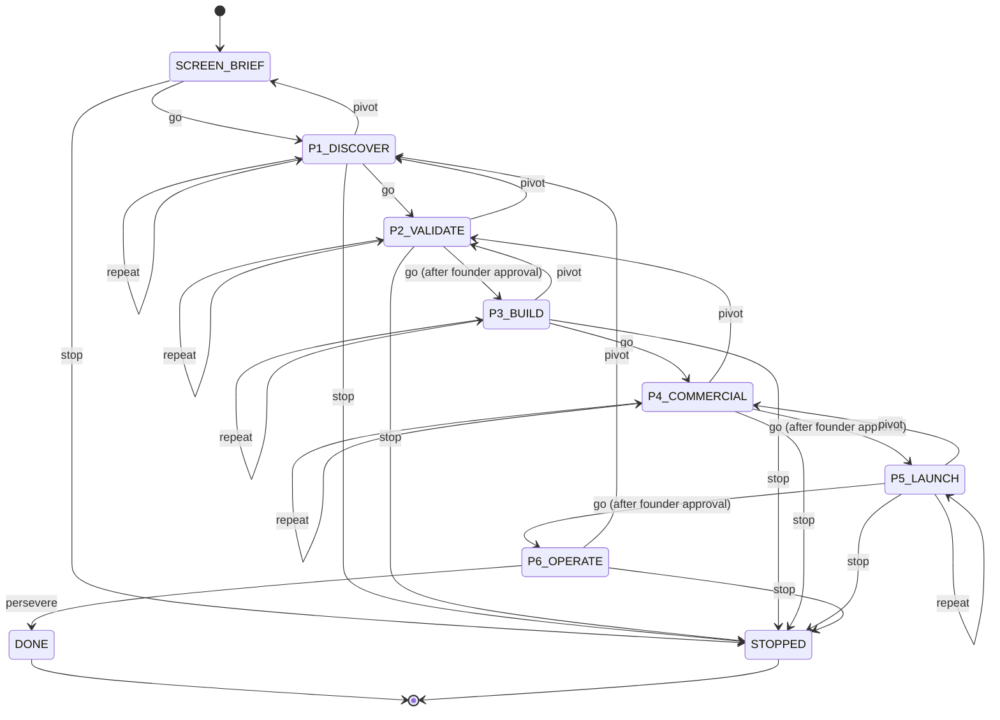

# Architecture

## Overview

One Python process (FastAPI web UI plus a CLI) runs a state machine in `orchestrator.py`. Each phase is one state. A state runs its agents in order, every generated file passes the output guardrail, and the state ends in a gate (`gates.py`) that returns exactly one of **go**, **repeat**, **pivot** or **stop**. Phases 2, 4 and 5 then block in `AWAITING_APPROVAL` until the founder approves or rejects in the UI or CLI. Every agent action, gate and founder decision is appended to the run's decision log by `decision_log.py`, the only writer. The model is any OpenAI-compatible endpoint (`llm.py`); the default is `qwen3:8b` on a local Ollama container.



A run lives in `runs/<run_id>/` (git-ignored): `state.json`, `approvals.json`, `decision_log.json` and `outputs/`. A run pauses with status `blocked` when it reaches a STUBBED step or the model is unreachable, and `python -m venture resume` (or the Resume button) continues it. `python -m venture promote RUN_ID` copies a finished **live** run into the committed `outputs/` and `decision_log.json`; it refuses runs made with `LLM_MODE=mock`.

## Phases

Every agent is a function `fn(ctx) -> StepResult` in `agents/<role>.py`, with its prompt in `prompts/<role>.md`. The orchestrator, not the agent, writes the file, applies the citation rule, runs the output check and logs the action.

### Phase 1: Discover

- **Agents:** `guardrails` (brief screen), `researcher`, `scorer`, `interviewer`.
- **Tools:** `sources.SourceRegistry.fetch` for public web pages (capped by `MAX_SOURCES`); the model client.
- **Method:** screen the founder brief (excluded categories, founder fit); find 3 to 5 opportunities from public discussions of the problem; score them on pain, willingness to pay, reach and founder fit, and estimate the cost and weekly hours of the smallest viable version; research competitors and what people already pay; write a Mom Test interview guide (past behaviour and current spend, no pitching).
- **Output:** `phase1_gate_brief_screen.md`, `phase1_step1_opportunities.md`, `phase1_step2_scoring.json`, `phase1_step3_market.md`, `phase1_step4_interview_guide.md`, `phase1_gate_decision.md`.

### Phase 2: Validate

- **Agents:** `strategist`.
- **Tools:** the model client; Phase 1 outputs and their registered sources.
- **Method:** a Lean Canvas where every box is sourced from Phase 1 or labelled `ASSUMPTION`; a static landing page with an honest call to action; a demand test whose target is fixed by code before any result exists. Sign-up results are MOCKED: the system never invents sign-ups.
- **Output:** `phase2_step1_lean_canvas.md`, `phase2_step2_landing_page.html`, `phase2_step3_demand_test.md`, `phase2_gate_decision.md`.

### Phase 3: Build

- **Agents:** `builder`.
- **Tools:** the model client; code-run product tests.
- **Method:** text digital products only (guide, template pack, checklist, mini-course). Write the smallest spec, build the product to it, then test it in code (every spec section present, length limits, output check passed). Write user docs.
- **Output:** `phase3_step1_mvp_spec.md`, `phase3_step2_product.md`, `phase3_step3_user_docs.md`, `phase3_gate_tests.md`.

### Phase 4: Commercial setup

- **Agents:** `commercial`.
- **Tools:** the model client; Phase 1 paying-source evidence.
- **Method:** a price grounded in what comparable products charge, with the reasoning and the assumptions stated; draft refund, privacy and terms text, labelled as drafts and not legal advice. The founder approves the price and policies.
- **Output:** `phase4_step1_pricing.md`, `phase4_step2_policies.md`, `phase4_gate_decision.md`.

### Phase 5: Sell/deliver/get paid (Launch; MOCKED)

- **Agents:** `launcher`, `delivery` (with `payments`, `refunds`, `reconcile`).
- **Tools:** the mocked ledger; the `@requires_approval` publish and post functions.
- **Method:** generate the store page and launch post drafts; the founder approves before anything goes out; then the mocked publish runs and the mocked payment test exercises sale to cash (see below). Nothing is published, posted or charged.
- **Output:** `phase5_step1_store_page.html`, `phase5_step2_launch_posts.md`, `payment_test_log.md`, `phase5_step4_publish_log.md`, `phase5_gate_decision.md`.

### Phase 6: Operate and learn

- **Agents:** `operator` (STUBBED).
- **Tools:** the model client; the decision log and mocked sales data.
- **Method:** a support FAQ from the product and policies; a memo comparing metrics with targets set before launch, recommending persevere, pivot or stop.
- **Output:** `phase6_step1_support_faq.md`, `phase6_step2_pivot_memo.md`, `phase6_gate_decision.md`.

## Gates

| State | What the gate checks | go | repeat | pivot | stop |
|---|---|---|---|---|---|
| `SCREEN_BRIEF` | Excluded category (physical goods; financial, investment or crypto; health or legal advice); borderline matches; founder has hours, budget and a skill | Phase 1 | — | — | STOPPED |
| `P1_DISCOVER` | Evidence thresholds (below) | Phase 2 | Phase 1 once | brief screen with a revised idea | STOPPED |
| `P2_VALIDATE` | Fewer than half the Lean Canvas claims are `ASSUMPTION`; then founder approval of the landing page | Phase 3 | Phase 2 | Phase 1 | STOPPED |
| `P3_BUILD` | Every product test passes | Phase 4 | Phase 3 once | Phase 2 | STOPPED |
| `P4_COMMERCIAL` | Founder approval of price and policies | Phase 5 | Phase 4 | Phase 2 | STOPPED |
| `P5_LAUNCH` | Founder approval before any publish or send | Phase 6 | Phase 5 | Phase 4 | STOPPED |
| `P6_OPERATE` | Metrics against pre-set targets | DONE | — | Phase 1 | STOPPED |

An outcome marked — is not defined for that state and leads to STOPPED. Each state allows one repeat and each run one pivot; past those limits the run stops.

**Phase 1 evidence thresholds** (set in `gates.PHASE1` before any run, never after):

- at least 3 fetched sources from 3 different domains that describe the problem;
- at least 1 fetched source showing someone already pays for a comparable solution;
- the brief's budget and weekly hours cover the scorer's estimate of the smallest viable version;
- fewer than half of the claims are labelled `ASSUMPTION`.

**When the system recommends STOP:** one miss means repeat once with new queries; two or more misses, or a miss after the repeat, means STOP, with each missed threshold written to `phase1_gate_decision.md`. A generated file that fails the output check twice also stops the run.

**Founder approval:** `AWAITING_APPROVAL` is a blocking sub-state. The approval is bound to an action id that hashes the exact content approved, so changed content needs a new approval. Reject leads to repeat or stop, as the founder chooses.

## Sale to cash

All of it is **MOCKED** in an in-memory ledger (`payments.py`, `delivery.py`, `refunds.py`, `reconcile.py`). No payment provider, SDK or sandbox is used and no money moves. `payment_test_log.md` records one test run:

1. **Payment triggers delivery.** Opening checkout is an outbound action and needs founder approval. A simulated payment event marks the order paid and calls `delivery.deliver`, which grants access.
2. **Idempotency prevents double delivery.** Delivery is keyed by `deliver:<order_id>`. The test sends the same payment event twice; the second is ignored and the order is delivered once.
3. **A refund revokes access.** `refunds.refund` needs founder approval, marks the order refunded and revokes access.
4. **Reconciliation** matches orders, payments, fees (an illustrative mock fee) and the recorded payout (payments minus fees minus refunds), and lists any mismatch.

## Data flow

```
founder brief (briefs/*.json)
   │  validate_brief → screen_brief
   ▼
orchestrator ── state ──► agent fn(ctx) ──► StepResult(content, claims, data)
   │                         │   ▲
   │                         │   └── llm.chat (tokens, cost)   sources.fetch (registry)
   ▼
citation rule: unfetched URL → ASSUMPTION ──► output check (block, regenerate once, stop)
   ▼
runs/<id>/outputs/<phase file>   +   runs/<id>/decision_log.json (one entry per action)
   ▼
gate → go / repeat / pivot / stop ──► AWAITING_APPROVAL? ──► founder (UI or CLI) → approvals.json
   ▼
promote (live runs only) ──► outputs/  +  decision_log.json  (committed)
```

Founder instructions during a run pass `guardrails.screen_request` first; refused ones are logged with `"outcome": "refused"` and never reach an agent.

## Built vs. stubbed

| Part | Status |
|---|---|
| State machine, transitions, repeat and pivot limits, persistence, resume | Built, tested |
| Gates and thresholds | Built, tested |
| Founder approval (`@requires_approval`, UI route, CLI prompt) | Built, tested |
| Guardrails (brief, request, output) | Built, tested with `tests/trick_prompts.json` |
| Decision log writer and schema check | Built, tested |
| Citation registry and ASSUMPTION stamping | Built, tested |
| Model client (OpenAI-compatible, token and cost counting, mock mode for tests) | Built |
| Web UI and CLI | Built |
| Payments, delivery, refunds, reconciliation, publishing, posting | MOCKED |
| Phase 1 to 5 agents | STUBBED |
| Phase 6 agents | STUBBED |

## Roadmap

1. Researcher with the source registry, then scorer, so the Phase 1 gate runs on real evidence.
2. Strategist and the Phase 2 gate.
3. Builder with code-run product tests; commercial; launcher.
4. Operator for Phase 6.
5. After the hackathon: a payment provider's test mode behind the same `@requires_approval` gate, more product types, and an evaluation set of briefs with known go and stop answers.
